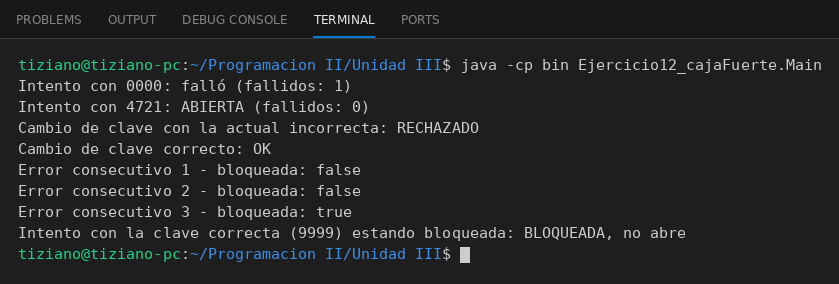

# CajaFuerte

Programación II - Unidad 3 - Ejercicio 12

## Consigna
Modelar la clase aplicando encapsulamiento: atributos privados y métodos públicos que validan antes de modificar el estado. Una caja fuerte con combinación oculta y bloqueo por intentos fallidos.

## Lógica
- Atributos privados: combinación, `bloqueada` e intentos fallidos.
- `abrir(clave)` devuelve `true` si coincide; si falla incrementa el contador y al tercer error bloquea.
- Una caja bloqueada no abre ni con la clave correcta.
- `cambiarCombinacion(actual, nueva)` exige la clave actual.

## Ejecución

